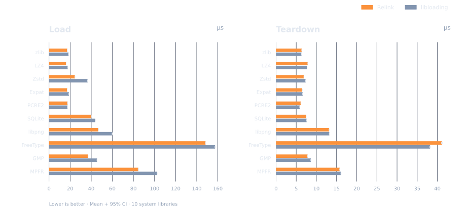
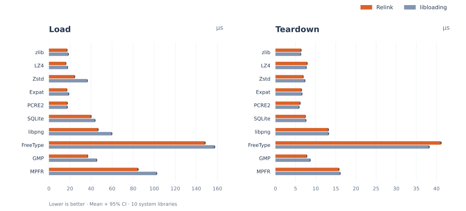
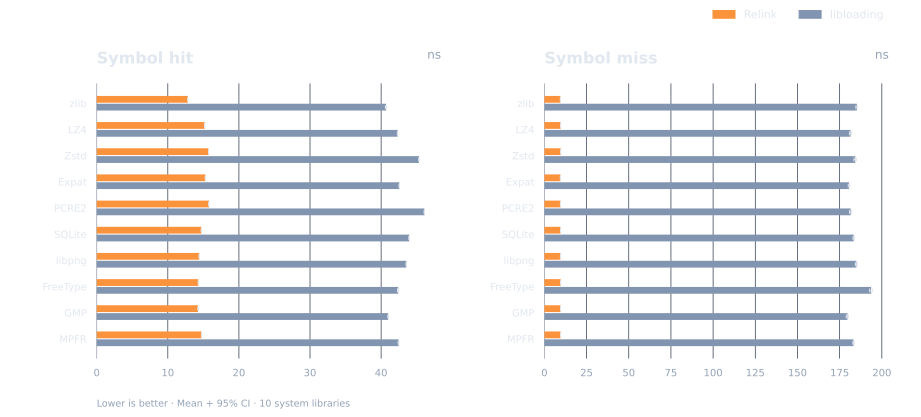
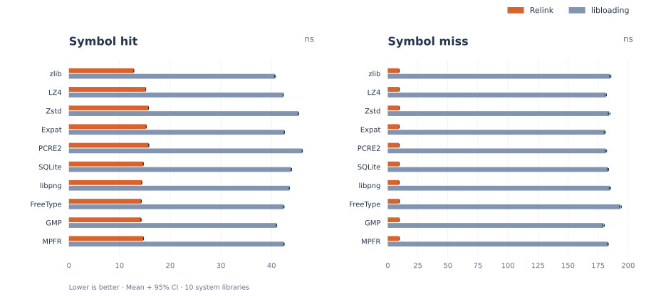
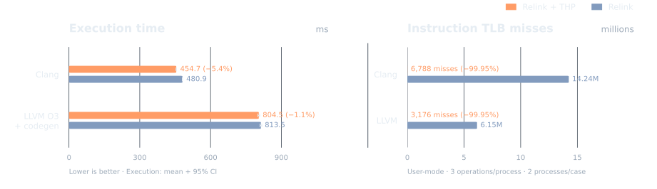
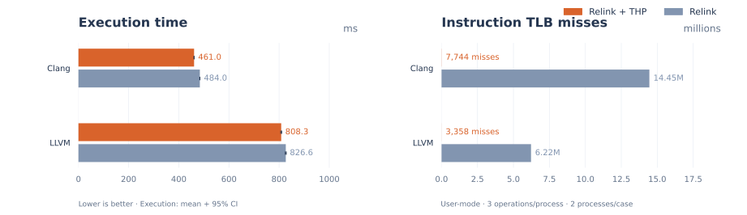

# Relink：Rust ELF 加载器与运行时链接器

<p align="center">
  
  
</p>

<p align="center">
  <a href="https://crates.io/crates/elf_loader"></a>
  <a href="https://crates.io/crates/elf_loader"></a>
  <a href="https://docs.rs/elf_loader"></a>
  
  <a href="https://github.com/weizhiao/Relink/actions/workflows/rust.yml"></a>
  
</p>

<p align="center">
  <a href="https://github.com/weizhiao/Relink/blob/main/README.md">English</a> | <a href="https://github.com/weizhiao/Relink/blob/main/README_zh.md">简体中文</a>
</p>

<p align="center">
  <strong>高性能 · 可定制 · 支持 no_std</strong>
</p>

Relink 是用 Rust 编写的 ELF 加载器与运行时链接器，面向插件、JIT 和自定义运行时。你可以自主控制依赖解析、符号绑定、内存布局与加载生命周期。

[快速开始](#快速开始) · [性能数据](#基准测试) · [平台支持](#平台支持) · [运行示例](https://github.com/weizhiao/Relink/blob/main/examples/README.md) · [API 文档](https://docs.rs/elf_loader)

## 核心能力

- **多种输入**：从文件或内存加载共享库、可执行文件与可重定位目标文件（`.o` / `.ko`）。
- **链接策略可控**：自定义依赖解析、符号作用域和重定位，通过 observer 跟踪或干预加载过程。
- **加载前优化**：先扫描再布局，支持 section 重排与热代码聚集；架构范围见[平台支持](#平台支持)。
- **适配你的运行时**：支持 `no_std`，可替换 mmap 与内存访问后端，接入内核、嵌入式或远程内存。

## 基准测试

在本次 10 个系统库与 `libloading` 0.9.0（glibc）的对照中，Relink 在 **9 个库上的加载耗时减少约 6–33%**，PCRE2 约慢 0.3%；全部 10 个库的**符号命中耗时约为 1/3**。
图中为平均耗时和 95% 置信区间，越低越好。

**加载与卸载 · µs**




卸载耗时整体相近。不计入 context 创建、销毁及宿主导入。

**符号查找 · ns**




符号查找比较的是公开 API：Relink 搜索根库导出，`dlsym` 还可能搜索依赖；未命中包含各自的错误处理成本。

复现：`taskset -c 2 bash ci/bench.sh`。依赖与测量口径见[基准指南](https://github.com/weizhiao/Relink/blob/main/benches/README.md)。

**透明大页优化**

在本次 Clang / LLVM 编译负载测试中，启用 `ThpPolicy::Collapse` 后，
**执行耗时减少 2.2–4.7%**，两组的**指令 TLB miss 均减少约 99.95%**。




执行耗时展示均值和 95% 置信区间，不含加载、大页合并、准备与校验。
iTLB 为整进程用户态计数，包含这些阶段；图中为两次计数的均值，越低越好。

测试于 2026-11-07，commit `e5a5b92`；环境为 Ryzen 9 7945HX、Linux 7.0.11 x86_64、
glibc 2.43、Rust 1.96.0，固定 CPU 2，使用热文件缓存。
采样设置、THP 配置、内存开销与复现步骤见[基准指南](https://github.com/weizhiao/Relink/blob/main/benches/README.md#thp-figure)。

## 快速开始

```toml
[dependencies]
elf_loader = "0.19.0"
```

下面的例子加载动态库、调用函数并释放模块。先按[示例指南](https://github.com/weizhiao/Relink/blob/main/examples/README.md#build-the-example-library)
编译 `libexample.so`，从仓库根目录运行；也可直接执行 `cargo run --example linker_load`。

```rust
use elf_loader::{LinkContext, Linker, input::PathBuf, linker::SearchPathResolver};
use std::ffi::c_int;

fn main() -> Result<(), Box<dyn std::error::Error>> {
    let mut context = LinkContext::for_process();
    let loaded = Linker::new()
        .with_resolver(SearchPathResolver::new())
        .run()
        .load(&mut context, PathBuf::from("target/example-library/libexample.so"))?;

    // SAFETY: example.c 定义了 int example_add(int, int)。
    unsafe {
        let add = context.module(loaded.root())?
            .get::<unsafe extern "C" fn(c_int, c_int) -> c_int>("example_add")?
            .ok_or("missing example_add")?;
        assert_eq!(add(2, 3), 5);
    }
    drop(loaded.release(&mut context)?);
    Ok(())
}
```

更多用法：[内存加载](https://github.com/weizhiao/Relink/blob/main/examples/load_from_memory.rs) · [目标文件](https://github.com/weizhiao/Relink/blob/main/examples/load_object.rs) · [布局重排](https://github.com/weizhiao/Relink/blob/main/examples/linker_scan_first.rs) · [宿主库导入](https://github.com/weizhiao/Relink/blob/main/examples/host_import.rs)。

## 平台支持

| 指令集 | 动态库 / 可执行文件 | Section 重排 | `.o` / `ET_REL` |
| --- | --- | --- | --- |
| `x86_64` | ✅ | ✅ | ✅ |
| `x86` | ✅ | 🚧 | 🚧 |
| `aarch64` | ✅ | 🚧 | 🚧 |
| `arm` | ✅ | 🚧 | 🚧 |
| `riscv64` | ✅ | 🚧 | ✅ |
| `riscv32` | ✅ | 🚧 | 🚧 |
| `loongarch64` | ✅ | 🚧 | 🚧 |
| `xtensa` | 🔧 | 🚧 | 🚧 |

✅ 支持 · 🔧 部分支持 · 🚧 待补齐。

Xtensa 目前支持动态重定位，但尚不支持 lazy binding 和 TLS 相关重定位。

## Feature 开关

默认 `full` 启用 `std`、`object` 和 `lazy-binding`。最小宿主配置：

```toml
elf_loader = { version = "0.19.0", default-features = false, features = ["std"] }
```

<details>
<summary>查看全部 feature</summary>

| Feature | 默认 | 作用 |
| --- | --- | --- |
| `std` | 是 | 启用标准库集成和默认线程存储；在 Linux/Android 上使用原生平台服务，在 Linux/glibc 上提供 `host::open` |
| `lazy-binding` | 是 | 启用内置的本机 PLT/GOT lazy binder |
| `object` | 是 | 启用可重定位目标文件（`ET_REL`）加载和 `LoaderRun::load_object()` |
| `version` | 否 | 启用带符号版本的查找，例如 `get_version()` |
| `log` | 否 | 启用基于 `log` 的加载与重定位诊断输出 |
| `portable-atomic` | 否 | 为不支持原生指针宽度原子操作的目标提供支持 |
| `use-syscall` | 否 | 使用 Linux syscall 后端；不能与 `std` 同时启用 |
| `full` | 是 | 便捷组合：`lazy-binding`、`object`、`std` |

</details>

TLS 通过 resolver 配置，无需 feature 开关；宿主库需要显式导入，见[示例](https://github.com/weizhiao/Relink/blob/main/examples/host_import.rs)。

默认 resolver 的所有注册（包括静态 TLS 和自定义 provider）都要求启用 `std` 的 Linux/Android 线程存储后端；其他平台及 `no_std` 环境需提供自定义 resolver。
线程清理和指针生命周期要求见 [TLS API](https://docs.rs/elf_loader/latest/elf_loader/tls/index.html)。
使用 `use-syscall` 时，需禁用默认 feature，且不能启用 `std`。

## 参与贡献

提交 [Issue](https://github.com/weizhiao/Relink/issues) 反馈问题，或按[贡献指南](https://github.com/weizhiao/Relink/blob/main/CONTRIBUTING_zh.md) 提交改进。

## 许可证

采用 [MIT](https://github.com/weizhiao/Relink/blob/main/LICENSE-MIT) 或 [Apache-2.0](https://github.com/weizhiao/Relink/blob/main/LICENSE-APACHE) 双许可证。

## 贡献者

<a href="https://github.com/weizhiao/Relink/graphs/contributors">
  
</a>
